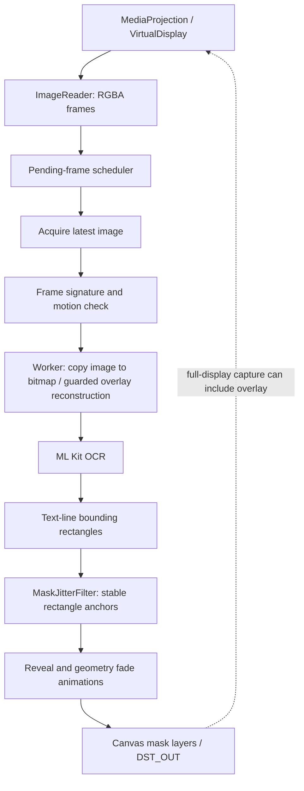

# Darker: project and rendering documentation

This document describes the current implementation. It covers the Flutter UI,
Android service lifecycle, screen capture, text recognition, rectangle
stabilization, and per-pixel mask composition. File links are relative to this
document.

## 1. Project structure

Darker places a non-touchable black overlay above other Android applications.
Text Aware mode detects text lines and reduces dimming inside rounded, softly
feathered rectangles around them. It does not redraw the text or modify the
application underneath.

| File | Responsibility |
| --- | --- |
| [lib/main.dart](../lib/main.dart) | Flutter UI, preferences, user/native opacity conversion, and method-channel calls. |
| [MainActivity.kt](../android/app/src/main/kotlin/com/desu1243/darker/MainActivity.kt) | Flutter/Android bridge, permission requests, and service commands. |
| [OverlayService.kt](../android/app/src/main/kotlin/com/desu1243/darker/OverlayService.kt) | Overlay window, foreground notification, capture resources, frame scheduling, and OCR. |
| [DimmingOverlayView.kt](../android/app/src/main/kotlin/com/desu1243/darker/DimmingOverlayView.kt) | Rectangle filtering integration, animations, and Canvas mask rendering. |
| [MaskJitterFilter.kt](../android/app/src/main/kotlin/com/desu1243/darker/MaskJitterFilter.kt) | Android-independent rectangle stabilization algorithm. |
| [AndroidManifest.xml](../android/app/src/main/AndroidManifest.xml) | Overlay and foreground-service permissions and Android components. |

The UI is Flutter, but the cross-application overlay and OCR pipeline are native
Android implementations. The presence of Flutter platform folders does not mean
this functionality is implemented on other platforms.

## 2. UI and persisted settings

The `Dimmer` page contains the status, horizontally scrollable calibration
samples, screen opacity, and text opacity. The text-opacity panel is absent when
Text Aware is disabled. The `Settings` page contains Text Aware, refresh interval,
jitter tolerance, collapsible appearance controls, and the keep-after-closing
switch. `PageView` and the bottom `NavigationBar` switch between the same pages.
The Start/Stop button stays outside the scrolling content.

Preferences are loaded before `runApp()` and passed to `DarkerApp`. Changes are
saved using `shared_preferences`; numeric values below are stored as doubles.
Restoration clamps numeric settings to their supported ranges.

| Preference key | Default | UI range / meaning | Change while running |
| --- | --- | --- | --- |
| `screenOpacity` | `0.50` | `0..1`, displayed as `0..100%` | Yes |
| `textOpacity` | `0.75` | `screenOpacity..1` | Yes |
| `textAware` | `true` | Enable capture and OCR | Stop overlay first |
| `refreshIntervalMs` | `400` | `50..500` ms | Yes |
| `jitterTolerancePx` | `5` | `0..20` screen pixels | Yes |
| `textMargin` | `12` | `0..32` dp | Stop overlay first |
| `cornerRadius` | `10` | `0..32` dp | Stop overlay first |
| `edgeSoftness` | `12` | `0..32` dp | Stop overlay first |
| `keepOverlayAfterClosing` | `false` | Keep service when removed from recent apps | Yes |

Defaults apply when a preference is missing; an existing saved `textAware=false`
is respected. Text opacity is raised and saved if screen opacity is increased
past it, so text regions cannot become darker than their surroundings.

The keep-after-closing value is also copied to native Android preferences:
`overlay_settings` / `keepOverlayAfterClosing`. The service can therefore read
it in `onTaskRemoved()` without a Flutter engine or an active activity.

## 3. Flutter/native communication

The method channel is `com.desu1243.darker/overlay`.

| Method | Purpose |
| --- | --- |
| `checkOverlayPermission` | Read whether Android permits drawing over other applications. |
| `requestOverlayPermission` | Open Android's overlay-permission settings. |
| `getOverlayState` | Return running/capture flags, native dim amounts, and Text Aware state. |
| `startOverlay` | Pass opacity, Text Aware, appearance, interval, and tolerance settings; request capture consent when needed. |
| `stopOverlay` | Send the service's stop action. |
| `updateOpacity` | Change background dimming. |
| `updateTextOpacity` | Change dimming inside text regions. |
| `updateRefreshInterval` | Change OCR scheduling and the duration used by subsequent fades. |
| `updateJitterTolerance` | Change stabilization for subsequent OCR results. |
| `setKeepOverlayAfterClosing` | Update native lifecycle preferences. |

`MainActivity` sends `onOverlayStarted` after it dispatches the capture-start
commands and `onCapturePermissionDenied` if consent is rejected. The first
callback is not a confirmation that an OCR result has already been rendered.
When Flutter resumes, it calls `_refreshNativeState()` to reconcile the UI with
the service. Interval and tolerance are restored from preferences; they are not
fields returned by `getOverlayState`.

## 4. Starting and stopping

With Text Aware disabled, Start creates the overlay without requesting screen
capture. With Text Aware enabled, the sequence is:

1. Flutter checks overlay permission and sends `startOverlay` with the settings.
2. `MainActivity` saves pending settings and opens the system capture-consent UI
   with `createScreenCaptureIntent()`.
3. After consent, it sends `ACTION_START`, then `ACTION_START_CAPTURE`, including
   the projection result code and consent intent.
4. The service enters foreground mode and creates the overlay window. Before
   obtaining the projection, it updates foreground mode to include the media
   projection service type.
5. The service obtains `MediaProjection`, registers its stop callback, and creates
   a virtual display and image reader.

The foreground notification opens the app and has a Stop action. Android 14+
uses the `specialUse` type for dimming and adds `mediaProjection` for capture;
older versions have version-specific foreground-service calls in
`startAsForeground()`.

`stopEverything()` releases capture, removes the overlay, clears running flags,
removes foreground status/notification, and calls `stopSelf()`. `onDestroy()`
also releases resources and closes the recognizer. The service returns
`START_NOT_STICKY`, so it does not request automatic restart after process death.

The manifest keeps `android:stopWithTask="false"` so the service can make the
decision in `onTaskRemoved()`: stop by default, or keep running if the native
preference is enabled. Removing the recent-app task is distinct from pressing
Home, which does not stop the overlay.

If the system stops only the projection, its callback calls `releaseCapture()`.
That clears the text mask and releases capture resources, but does not remove
the dimming window. A live push notification to Flutter for this event is not
implemented; state is refreshed when Flutter resumes.

## 5. Processing pipeline



### 5.1 Capture format and dimensions

`setupVirtualDisplay()` takes dimensions from `currentWindowMetrics.bounds` on
Android 11+, with `resources.displayMetrics` as the older-version fallback.
`ImageReader` uses `RGBA_8888`, three image slots, and a surface passed to
`createVirtualDisplay()` with `VIRTUAL_DISPLAY_FLAG_AUTO_MIRROR`.

Capture is not synchronized to Flutter frames or touch callbacks. Incoming
images trigger an image-available listener on the service's main handler.

### 5.2 Scheduling and backpressure

The listener sets `pendingFrameAvailable=true` and calls
`schedulePendingFrameDrain()`. It does not start recognition directly.

Scheduling requires a running capture, a pending frame, and no OCR already in
flight. There is one pending drain runnable, rescheduled against the same
deadline rather than a delay measured from each new frame:

```text
nextOcrAt = lastOcrAtMs + refreshIntervalMs
delay = max(0, nextOcrAt - uptimeNow)
```

The first recognition is scheduled immediately. `lastOcrAtMs` records the start
of recognition, so the setting is a minimum start-to-start interval, not a sleep
after recognition finishes. There are no concurrent OCR jobs in the normal
capture flow. With available frames, the practical interval is approximately
the larger of the configured interval and processing time, plus scheduling
overhead; it is not a guaranteed frame rate.

The drain uses `acquireLatestImage()` rather than processing every queued frame.
This favors current screen content over a backlog. Images arriving while OCR is
busy leave the pending flag set; OCR completion schedules the next drain. The
last queued image after a scroll can therefore be processed without another
touch. If no new image is available, the pending flag is cleared. The code does
not run OCR on a cached bitmap periodically when no frames arrive.

### 5.3 Motion signature

Before OCR, `acceptCapturedFrame()` samples an 18-by-32 grid: 576 locations from
the image buffer. Offsets use the image plane's `rowStride` and `pixelStride`.
Each RGB sample is reduced to integer brightness:

```text
brightness = (30 * red + 59 * green + 11 * blue) / 100
frameDifference = mean(abs(previousBrightness - currentBrightness))
```

A difference of at least `5.0` is treated as motion. This is a brightness
threshold, unrelated to the user's pixel-based jitter tolerance. Motion
detection does not gate OCR: recognition still runs for the accepted frame.

After every successful OCR result, `ignoreMotionUntilMs` is set to current
uptime plus **360 ms**. During this window the frame signature is still updated,
but its difference cannot trigger mask hiding. This prevents some overlay
animation changes in full-display capture from being treated as scrolling.
The suppression interval is fixed; it is neither the refresh interval nor the
fade duration, and it does not delay OCR.

Implementation detail: `motionActive` becomes true on the first unsuppressed
motion event and is reset by `releaseCapture()`, not by each OCR result. As
written, this path requests a hide once per capture session. Subsequent updates
continue through OCR and geometry cross-fades; there is no continuous
touch-driven movement/stillness mode.

### 5.4 Image conversion and OCR

`imageToBitmap()` copies the RGBA plane into an `ARGB_8888` bitmap. Image rows can
have padding, so it computes a padded width from row/pixel strides and crops
back to `image.width` when needed. The captured `Image` is closed with `use`;
the copied bitmap remains alive until asynchronous recognition completes and
is then recycled. `CapturedFrameBitmap.kt` preserves the row-stride conversion
and explicitly draws padded crops into mutable ARGB_8888 bitmaps.

Image conversion and optional reconstruction run on one background executor;
the acquired Image stays alive until its copy completes. Reader disposal is
serialized behind that copy. Only the copied bitmap reaches ML Kit.

The service lazily creates ML Kit's Latin-script text recognizer with
`TextRecognizerOptions.DEFAULT_OPTIONS` and passes
`InputImage.fromBitmap(bitmap, 0)`. No application-level thresholding, image
normalization, resizing for OCR, or rotation compensation is applied. The
optional debug-only reconstruction stage described in section 12 runs before
recognition when the current capture session has been explicitly validated.

On success, the service traverses `result.textBlocks`, then `block.lines`, and
copies every non-null line `boundingBox` to a `Rect`. These are axis-aligned
line boxes, not glyph outlines, individual characters, or speech-bubble
boundaries. Recognized strings are not needed for rendering. The pipeline has
no translation or AI service and does not save or upload frames or OCR text.
Its current recognizer is configured for Latin script, not a separate
Korean/Japanese/Chinese recognition model.

A capture-generation counter is sampled when OCR starts. Success handlers
ignore results if capture has stopped or the generation changed. Recognition
failure logs a warning and leaves the existing mask unchanged. A successful
result containing no lines is different: it supplies an empty new mask, so the
old regions can fade away.

## 6. Stabilizing text rectangles

`DimmingOverlayView.setTextRegions()` converts detections to `MaskRegion` values
and invokes `MaskJitterFilter.stabilize()` before changing animation state.

For each new rectangle, the filter finds the nearest unmatched accepted
rectangle using the largest displacement among its four edges:

```text
edgeDistance(a, b) = max(
    abs(a.left - b.left), abs(a.top - b.top),
    abs(a.right - b.right), abs(a.bottom - b.bottom)
)
```

If that distance is at most the tolerance, the old rectangle is reused exactly.
Otherwise the new coordinates are accepted. Each old rectangle can anchor at
most one new rectangle. Results are sorted by top, left, bottom, and right to
normalize simple OCR ordering changes. Matching is greedy and geometric; it
does not use recognized strings or persistent text identities.

Tolerance is expressed in **overlay screen pixels**, not dp. To compare capture
coordinates, the view supplies the same scale used for rendering:

```text
scale = overlayWidth / capturedImageWidth
toleranceInCaptureCoordinates = tolerancePx / max(0.001, scale)
```

If capture dimensions change, old rectangles are not used as anchors. A zero
tolerance accepts all nonzero coordinate movement while still allowing exact
matches and order normalization.

The anchor is the last accepted target rectangle, not the previous raw OCR
result and not a snapshot of the partially animated mask. With a 5 px tolerance,
successive positions at offsets 2, 4, and 5 px retain the anchor. An offset of
6 px updates it. Slow scrolling therefore accumulates instead of being ignored
indefinitely. A stable neighbor can remain anchored while a moving line updates.

New rectangles are included immediately and missing rectangles are removed from
the target immediately. The filter does not debounce intermittent missing lines
or stabilize changes where OCR splits/merges lines. Those changes still produce
geometry transitions and can contribute to visible variation.

## 7. Opacity model

UI opacity expresses screen visibility across the permitted dimming range.
It is intentionally opposite to black-overlay alpha:

```text
M = MAX_DIM_AMOUNT = 0.70
S = screenOpacity / 100
T = textOpacity / 100, constrained to T >= S
D = (1 - S) * M       // background native dim amount
Dt = (1 - T) * M      // native dim amount inside fully revealed text
```

100% means no dimming; 0% means maximum allowed dimming. These percentages are
normalized controls, not measured display luminance or literal light
transmission percentages. For example, screen opacity 50% maps to black alpha
0.35, not 0.50. Text opacity 70% maps to alpha 0.21.

There are two alpha stages. The Android window's `LayoutParams.alpha` stays at
`0.70`. The black pixels drawn inside it vary with `D / M`. In the ideal
full-coverage case, their product is `M * (D / M) = D`, subject to 8-bit alpha
rounding. Keeping window alpha constant avoids the composition-mode change
previously associated with a brightness jump on some devices.

The window is `TYPE_APPLICATION_OVERLAY` on Android 8+ and `TYPE_PHONE` on older
versions. It uses `FLAG_NOT_TOUCHABLE`, `FLAG_NOT_FOCUSABLE`,
`FLAG_LAYOUT_IN_SCREEN`, and `FLAG_LAYOUT_NO_LIMITS`. Its alpha limit is chosen
to stay below the touch-obscuring limit targeted by the implementation. It does
not receive touches or require an accessibility service.

## 8. Mapping boxes to rounded mask regions

`onDraw()` maps captured coordinates to the overlay using uniform scaling:

```text
scaleX = overlayWidth / sourceWidth
scaleY = scaleX
left   = source.left   * scaleX - marginPx
top    = source.top    * scaleY - marginPx
right  = source.right  * scaleX + marginPx
bottom = source.bottom * scaleY + marginPx
```

Using the same scale for both axes avoids stretching vertically just because
navigation bars reduce overlay height. There is no separate offset/letterbox
transform. `sourceHeight` helps detect capture-size changes but does not set a
different vertical scale.

Margin, corner radius, and edge softness are stored in dp and multiplied by
Android display density. They are not multiplied by capture scaling afterward.
Each expanded box is drawn with `drawRoundRect()` and antialiasing. When softness
is positive, `BlurMaskFilter(featherPx, NORMAL)` softens the mask boundary;
zero uses no blur. This is a blurred alpha edge, not a change to the source
text or background colors.

## 9. Fade and mask composition

### 9.1 Two animation values

The view tracks:

- `revealProgress` (`r`): overall visibility of text cut-outs, from 0 to 1.
- `transitionProgress` (`t`): blend from previous geometry to current geometry.

All animated reveals, hides, and geometry transitions use
`DecelerateInterpolator` and a duration of `refreshIntervalMs / 2`, using integer
milliseconds. Examples: 50 ms interval gives 25 ms fade; 400 ms gives 200 ms;
500 ms gives 250 ms. Updating the interval changes the duration used by newly
started animations; existing animators are not explicitly retimed.

When a first mask arrives, or the old target has no regions, the view installs
the new geometry and fades its reveal from zero. Otherwise it retains the old
geometry in `previousTextRegions`, installs the new geometry in `textRegions`,
and animates `t` from 0 to 1 while revealing toward 1.

If stabilized regions and image dimensions are unchanged, and reveal already
targets 1, the method returns without restarting either fade. When reveal is
targeting zero, an unchanged OCR result can still request a reveal again.

If genuinely different geometry arrives before a cross-fade finishes, the old
animator is canceled and the previous *target* becomes the old geometry for the
next transition. The code does not snapshot the current blended raster. Shorter
fades reduce this situation, but they do not guarantee that all interruptions
are visually continuous.

### 9.2 Canvas layers and alpha removal

The view uses a software layer for its Canvas/blur/compositing implementation.
Rendering proceeds as follows:

1. Save a full-size overlay layer and draw black over the entire area with
   alpha `floor(255 * D / M)`.
2. Compute the fraction of dimming to remove inside text:

   ```text
   removalFraction = D > 0 ? clamp(1 - Dt / D, 0, 1) : 0
   ```

3. Save a mask layer whose restore paint uses `PorterDuff.Mode.DST_OUT` and
   alpha `floor(255 * r * removalFraction)`.
4. Draw rounded, optionally blurred regions into that layer. In a geometry
   transition, draw the previous mask with weight `1-t`, then add the current
   mask with weight `t` using `PorterDuff.Mode.ADD`.
5. Restore the mask layer. `DST_OUT` removes the corresponding fraction of the
   black overlay alpha. Restore the outer layer to the view.

Let `Aold(x,y)` and `Anew(x,y)` be the masks' per-pixel coverage, including blur
and antialiasing. The intended geometry blend is:

```text
coverage = (1 - t) * Aold + t * Anew
effectiveBlackAlpha = D * (1 - r * removalFraction * coverage)
```

Fully covered common pixels remain covered as weights change. Pixels only in
the old region fade back to the background dim amount; pixels only in the new
region become less dim. This preserves common coverage instead of hiding and
revealing the whole mask for every detection. Blurred edges have partial
coverage; overlapping rounded rectangles combine through Canvas composition.
The equations describe ideal alpha values before integer rounding.

At full reveal and full coverage, black alpha is `Dt`. Outside text it is `D`.
With text opacity 100%, `Dt=0`, so text regions can become fully clear. If text
opacity equals screen opacity, `removalFraction=0` and there is no brightness
difference. When background opacity is 100%, `D=0` and no dimming is rendered.

## 10. Current limitations and debugging

Full-display capture can contain the dimming overlay itself. There is no
implemented overlay-exclusion or inverse-dimming preprocessing step. Changes
in the mask can therefore affect subsequent OCR results. The 360 ms motion
guard, rectangle tolerance, unchanged-mask shortcut, and cross-fades address
different parts of this feedback; they do not make the input overlay-free.

The capture intent lets the system offer a single-app or full-screen choice on
supported devices. The current implementation has no
`onCapturedContentResize()` handling, rotation rebuild, or explicit app-window
offset mapping. Single-app capture, rotation, and letterboxing therefore need
device testing before assuming coordinate alignment is correct.

Other practical limits are the Latin-script recognizer, axis-aligned boxes for
rotated text, recognition latency, bitmap copies, software blur, and full-size
offscreen Canvas layers. Lower refresh intervals allow more work; they do not
guarantee OCR completes faster or that animation frames meet the display rate.

Useful debugging distinctions:

| Symptom | Relevant implementation |
| --- | --- |
| Small edge jitter on stationary text | OCR box variation, jitter tolerance, and changes in line grouping. |
| Missing line briefly dims | Successful OCR omitted a box; tolerance does not retain missing boxes. |
| Mask trails a slow scroll | Accepted anchors, tolerance, OCR processing latency, and fade duration. |
| Geometric jump during fast updates | Cross-fade interruption uses the previous target, not the current raster. |
| Mask offset in app-only capture | Capture dimensions, letterboxing, and absent offset mapping. |
| Refresh set to 50 ms but updates slower | Single OCR job, processing time, available frames, and main-handler scheduling. |

Logs use the tag `DarkerOverlay`. They include capture dimensions, recognized
line counts at verbose level, and OCR failures; recognized strings are not
logged by this pipeline.

## 11. Build and verification

Run from the repository root:

```powershell
flutter pub get
flutter run
flutter analyze
flutter test --reporter expanded
flutter build apk --debug
```

Run native rectangle-filter tests from `android`:

```powershell
.\gradlew.bat :app:testDebugUnitTest
```

Native tests in
[MaskJitterFilterTest.kt](../android/app/src/test/kotlin/com/desu1243/darker/MaskJitterFilterTest.kt)
cover tolerance boundaries, accumulated slow scrolling, OCR order changes,
zero tolerance, capture scaling, independent neighbors, added/removed boxes,
and one-to-one anchor use. Flutter tests in
[widget_test.dart](../test/widget_test.dart) cover controls, preference
restoration, and live interval/tolerance updates through a mocked channel.
These tests do not validate physical-device composition, actual OCR quality,
or perceived flicker.

For manual verification, test stationary text and slow/fast scrolling at both
refresh endpoints, use tolerance 0 and 5 px, compare text/background opacity,
and remove the task from recents with each keep-after-closing setting. Check
full-screen and app-only capture separately. The current release build
configuration uses the debug signing configuration; production signing is not
configured.


## 12. Overlay-aware reconstruction

### 12.1 Components and actual alpha

`OverlayAlphaRenderer.kt` now owns the original software Canvas operations. Both
`DimmingOverlayView.onDraw()` and `OverlayFrameReconstructor.kt` call this exact
renderer, including saveLayer, DST_OUT, ADD, integer paint alpha, rounded corners,
uniform capture-to-overlay scale, and BlurMaskFilter.NORMAL. The visible mask
algorithm, MaskJitterFilter, animation timings and Flutter settings are unchanged.

For each raster pixel, let `q` be its resulting 8-bit software alpha. Effective
black alpha is `q / 255 * windowAlpha`, with windowAlpha exactly 0.70 in this
service. The window factor is applied once, after all Canvas layer operations.
Outside masks, `q = floor(255 * D / 0.70)`. At D=0.35 this gives q=127 and an
effective alpha of about 0.348627, not exactly 0.35. The mask restore paint uses
`floor(255 * reveal * clamp(1-Dt/D))`; Canvas performs the remaining blend and
integer rounding. Blurred rectangles overlap through source-over inside each
mask, so overlap coverage exceeds a single blurred edge. Old/new mask layers
use complementary floored weights and ADD. This reproduces the implementation,
rather than treating masks as binary rectangles or assuming an exact linear union.

The worker reconstructs each RGB channel with `round(C / (1-alpha))`, clamps it
to 0..255 and preserves the input pixel alpha. Nonfinite/out-of-range alpha or
transmission below 0.05 cannot recover the source; the entire frame is bypassed
before mutation. Synthetic inverse error is bounded by approximately
`0.5/(1-alpha)+0.5` channel levels for nearest-rounded capture channels. At the
normal maximum effective alpha of 0.70 this is under 2.17 levels. Tests of the
selected synthetic mask at D=0.35 permit 2 levels. This model does not undo color
management, HDR, other overlays, clipping, or lost source quantization.

### 12.2 Coherent state and conservative timing

`OverlayRenderSnapshot.kt` contains immutable value geometry, dim amounts,
window alpha, capture source size, overlay size, reveal/transition progress,
margin/radius/softness, render version, draw time and stable-since time. Lists
are defensive unmodifiable copies; no RectF or animator crosses threads. The
existing transform remains uniform `overlayWidth/sourceWidth` with zero offset.
Reconstruction currently accepts only identity-size alignment; mismatched
heights, insets, app-only capture, letterboxing and resizing are not guessed.

The UI publishes a snapshot after the shared drawing code runs. It retains only
the latest snapshot, including how long that exact appearance has remained
unchanged. This is sufficient because animated and superseded states are never
reconstructed. Snapshot acquisition checks both animator running flags and
pending view properties: a setter awaiting onDraw also causes bypass. The worker
uses the snapshot selected at frame acquisition, never the animation state at
OCR launch. Interrupted transitions also bypass until their final state settles.
The existing previous-target interruption behavior remains; it can itself cause
a visual jump and is not repaired by reconstruction.

Image.timestamp is source-dependent, not guaranteed to share a timebase with
System.nanoTime or uptimeMillis. See the
[Android Image timestamp contract](https://developer.android.com/reference/android/media/Image#getTimestamp()).
Scheduling still uses uptimeMillis; reconstruction compares only Image.timestamp
and System.nanoTime **after session-specific validation of that relationship**.
No offset is inferred from arrival time. Fresh captures must be positive, not in
the future, at most 2 seconds old and at least 100 ms after the final appearance
was drawn. Old captures preceding that state are rejected. Stable snapshots do
not expire merely because an unchanged overlay has not redrawn recently.

onDraw is not a presentation fence. The 100 ms settle interval is a conservative
policy, not a platform guarantee. Calibration must demonstrate compatible clocks
and presentation latency below that interval on the particular configuration.
Without that evidence the capability stays off. Animations always use the
original captured frame; no claim is made of reconstructing their captured pixels.

### 12.3 Capability guard and reproducible manual calibration

Default operation, including every release build, bypasses reconstruction.
Text Aware does not imply overlay inclusion. There is no reliable automatic
presence detector for arbitrary app content, so this implementation deliberately
requires debug-only calibration for **each capture session**. No overlay is hidden
and shown by the normal pipeline. No frame exporter or automatic image storage
is added.

Use a debug build on a controlled, stationary test scene containing known RGB
patches and these text samples: white/black, black/white, gray/gray, small
antialiased type, decorative fonts, closely spaced lines, rounded corners,
overlapping masks and text crossing a feathered edge. Keep brightness, color
mode, orientation, capture size and the selected full-display target fixed.

1. Leave reconstruction disabled. In the debugger, inspect the owned bitmap
   after `imageToBitmap()` on the worker, using memory inspection or an explicitly
   requested temporary export outside this code. Obtain a reference at D=0
   (text dimming also zero), then an equivalent dimmed frame after settling.
   This manual experiment changes opacity once per sample; it is not part of
   normal capture. Do not use adb screencap as a substitute for MediaProjection.
2. Compare patch ratios against the shared raster `q/255 * 0.70`. Test D=0,
   0.175, 0.35 and 0.70; test text dimming zero and partial. If dimmed captures
   instead match the D=0 reference, the overlay is absent: leave the guard off.
   Exclude protected content, app-only capture, letterboxing, rotation and any
   nonidentity mapping. Include reference differences away from text and within
   a band around blurred edges. Record MAE, maximum error and boundary MAE.
3. Inspect Image.timestamp, acquiredNanos, drawnAtNanos and stableSinceNanos
   during controlled opacity changes. Confirm the capture source uses the
   System.nanoTime timebase, timestamps advance normally, and visible/captured
   state changes settle within 100 ms. Repeat after sleep/resume. Similar arrival
   timestamps alone are insufficient evidence. If uncertain, do not validate.
4. For the currently running session only, copy the exact token logged as
   `Reconstruction calibration session: ...`. It includes build fingerprint,
   initial dimensions, rotation and a unique start time. While paused in the
   service debugger, enable the attestation with this expression (replace TOKEN):

   ```kotlin
   getSharedPreferences("overlay_settings", 0).edit()
       .putString("reconstructionValidatedSession", "TOKEN")
       .putBoolean("reconstructionEnabled", true).apply()
   ```

   Use debugger evaluation so the live SharedPreferences instance is updated;
   editing its XML externally does not reliably invalidate Android's cache.
   This attests all checks above, not just presence. Capture restart invalidates
   the token; rotation, size mismatch, crop or uncertain timing bypasses it.
5. Compare corrected owned bitmaps before ML Kit with reference frames. Record
   whole-image and boundary-band MAE/max error; allow for amplified quantization.
   For at least 100 stationary OCR samples per condition, use debugger inspection
   of line boxes to record line count, maximum edge displacement, fraction of
   changed boxes and missing lines. Do not log recognized strings. Repeat A/B
   with `reconstructionEnabled=false` using the same session and settings, at
   50/400/500 ms refresh intervals. Verify absent-overlay captures remain bypassed.
6. Inspect middle-of-fade frames separately. Their reconstruction must be skipped.
   Verify release/rotation/restart while a worker or OCR job is active. Compare
   normal mask appearance and touch pass-through with reconstruction disabled.

Calibration is still required; no MediaProjection/reference-image comparison or
physical-device OCR stability result has been established by the automated tests.
A future production enablement needs verified platform profiles or a stronger
capability detector. Do not remove this guard on the strength of math tests.

### 12.4 Ownership, fallback and performance

One slot covers conversion, reconstruction and asynchronous OCR. It remains held
across capture generation changes until the old operation completes. Obsolete
results are discarded; stale projection stop callbacks cannot stop a new session.
The copied bitmap is exclusively owned by that task and is recycled on completion,
stale-generation rejection or synchronous OCR startup failure. Reconstruction
prepares output in reusable storage before changing that bitmap. Failures keep
the original OCR behavior and do not clear text masks. Conversion failures drop
that frame and release the slot. ImageReader closes on the same worker after any
image copy; reconstruction buffers are released there on capture shutdown.

Bypass reasons include unvalidated session or disabled A/B switch, animation or
pending undrawn state, missing snapshot, generation mismatch, dimension mismatch,
non-full crop, changed rotation, old/future/unknown timestamp, unsettled appearance,
invalid alpha/bitmap and allocation/render failure. Debug logs report the reason,
dimensions, render version, capture age, reconstruction duration, alpha range,
pixel count and retained buffer bytes. OCR logs only line counts. No text or full
pixel arrays are logged. Detailed instrumentation is disabled in release builds.

There is no bitmap rasterization per UI animation frame beyond the original
view drawing. The worker caches the stable software raster, a compact alpha byte
per pixel and a 256x256 byte channel lookup. A reusable IntArray stages corrected
pixels. Alpha/raster/lookup regenerate only when appearance changes; bitmap and
array allocations change only with dimensions or after resource release. Canvas
saveLayer/blur may allocate additional transient buffers, not included in retained
buffer metrics. No extra GPU readback is introduced.

Measured on the connected Pixel_7 Android 17/API 37 x86_64 emulator, debug code,
1080x2400, one rounded feathered text region, six instrumented iterations:

| Version | Cold reconstruction | Warm median (5 iterations) | Retained reconstruction buffers |
| --- | --- | --- | --- |
| Initial per-channel division / row reads | 598.5 ms | 465.8 ms | 20,740,320 bytes |
| Cached alpha / channel lookup (first run) | 159.0 ms | 11.24 ms | 23,393,536 bytes (22.31 MiB) |
| Cached alpha / channel lookup (final run) | 189.1 ms | 11.30 ms | 23,393,536 bytes (22.31 MiB) |

These exclude capture conversion, OCR, source bitmap (~9.89 MiB), test-only
reference raster, Canvas transient layers and system capture buffers. Emulator
measurements are not phone battery, GPU, real-time latency or production memory
measurements. Rapidly changing geometry pays rasterization cost again; warm-cache
numbers are not a bound. The minimum refresh interval still controls start slots,
with backpressure when total work exceeds it. No concurrent OCR jobs are added.

### 12.5 Automated validation and outstanding work

`OverlayReconstructionTest.kt` separates pure inverse math and frame eligibility.
`OverlayAlphaRendererTest.kt` uses Robolectric 4.14.1 native graphics at API 28
(not its legacy Canvas shadow) to check two-stage alpha, integer rounding, reveal,
text dimming, rounded corners, blurred overlap, geometry transitions, synthetic
RGB reconstruction, pending UI state, immutable snapshots, mismatch/near-opaque
fallback and buffer cleanup. Existing rectangle stabilization tests remain.
`CapturedFrameBitmapTest.kt` checks padded/unpadded mutable crops, alignment,
independence from the capture buffer and bitmap disposal.
`OverlayReconstructionDeviceTest.kt` runs actual Android Canvas, verifies padded
RGBA channel order, and runs the above benchmark on the connected emulator.
It does not request MediaProjection or read screen content.

Verification commands:

```powershell
flutter analyze
flutter test --reporter expanded
.\android\gradlew.bat -p android :app:testDebugUnitTest
.\android\gradlew.bat -p android :app:connectedDebugAndroidTest
flutter build apk --debug
```

Robolectric and AndroidX test dependencies are test-only; there is no new runtime
network dependency. Math/raster tests and emulator instrumentation cannot establish
real compositor accuracy, overlay inclusion, timestamp compatibility, actual OCR
stability or elimination of visible flicker. Physical-device validation remains
outstanding; reconstruction therefore remains guarded and the overall outcome is
partial pending that validation.

Verification recorded on 2026-11-08: Flutter analysis clean; 3 Flutter tests,
33 native unit tests (including all 8 existing MaskJitterFilter tests), and 2
Android emulator instrumentation tests passed. Debug APK built successfully at
`build/app/outputs/flutter-apk/app-debug.apk`. Existing Android Gradle plugin
configuration deprecation warnings remain. No physical phone was used and no
MediaProjection presence/calibration or real OCR A/B test was performed.
